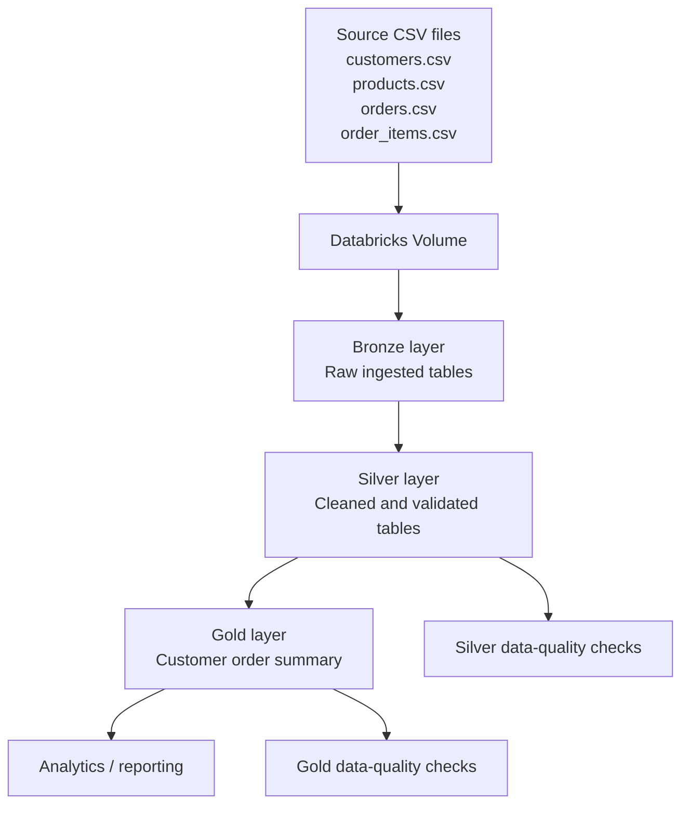

# E-commerce Data Engineering Project | Databricks, PySpark & Medallion Architecture

A beginner-friendly data engineering portfolio project that transforms raw e-commerce CSV files into cleaned, analytics-ready tables using **Azure Databricks / Databricks notebooks and PySpark**.

> **Project status:** Bronze, Silver, Gold, Silver data-quality checks, and Gold data-quality checks are completed in the Databricks workspace. This repository documents that work. Add screenshots and confirm the setup details below before publishing. Do not describe Azure Data Lake Storage or scheduled workflows as implemented unless you actually add and test them.

## Project objectives

- Ingest raw e-commerce CSV data into a Bronze layer.
- Clean and standardize data in the Silver layer.
- Build a business-facing customer order summary in the Gold layer.
- Run data-quality checks on Silver and Gold data.
- Document the pipeline so another person can understand and reproduce the work.

## Architecture

**Data flow:** CSV files → Databricks Volume → Bronze → Silver → Gold. Separate notebook checks validate the Silver and Gold outputs.

## Source data

The project uses four CSV files:

| File | Purpose |
|---|---|
| `customers.csv` | Customer attributes such as customer ID, name, and country |
| `products.csv` | Product attributes such as product ID, name, and category |
| `orders.csv` | Order-level details such as order ID, customer ID, date, and status |
| `order_items.csv` | Order line items, including order-item ID, order ID, product ID, and quantity |

The files are project inputs. Do not commit private, licensed, or sensitive data. If your sample files are synthetic or safe to share, you may include them; otherwise explain how to obtain or create sample data.

## Medallion layers

### 1. Bronze — ingestion
- Reads source CSV files from a Databricks Volume.
- Loads the ingested data into Bronze tables.
- Preserves a raw/landing representation for downstream processing.

Notebook: `01_bronze_ingestion.py`

### 2. Silver — cleaning and standardization
- Reads the Bronze tables.
- Applies the cleaning and validation steps implemented in the notebook.
- Writes cleaned tables for downstream analysis.

Tables referenced by the project:
- `workspace.silver.customers`
- `workspace.silver.products`
- `workspace.silver.orders`
- `workspace.silver.order_items`

**Important:** Update this section if your Silver notebook applies additional specific transformations, such as explicit type casting, trimming, deduplication, or invalid-record filtering. Document only transformations that are present in your code.

### 3. Gold — business aggregation
The Gold notebook joins Silver `orders`, `order_items`, and `customers`, then groups the results by customer.

Output table:
- `workspace.gold.customer_order_summary`

The summary includes:
- `total_orders` — distinct number of orders per customer.
- `completed_orders` — distinct orders whose status is `Completed`.
- `cancelled_orders` — distinct orders whose status is `Cancelled`.
- `total_quantity_ordered` — sum of item quantities across the customer's joined order rows.

The output is ordered by total quantity ordered, highest first. Check your actual notebook for any extra columns or business rules and update this description if needed.

## Data-quality checks

The project includes separate checks for Silver and Gold. The precise implementation is defined in the notebooks; the rules below describe the intended validation coverage.

### Silver layer
| Table | Fields / rule | Expected result |
|---|---|---|
| `customers` | `customer_id`, `customer_name`, `country` are not null | No null values in required fields |
| `products` | `product_id`, `product_name`, `category` are not null | No null values in required fields |
| `orders` | `order_id`, `customer_id`, `order_date`, `status` are not null | No null values in required fields |
| `order_items` | `order_item_id`, `order_id`, `product_id`, `quantity` are not null | No null values in required fields |

Recommended additional rules, if not already implemented:
- Primary-key uniqueness for `customer_id`, `product_id`, `order_id`, and `order_item_id` in the appropriate tables.
- `quantity` must be greater than zero.
- Product `price`, if present, must not be negative.
- Order statuses should belong to the project's accepted status list.
- Foreign-key checks should identify orders with missing customers and order items with missing orders or products.
- Date and numeric columns should have appropriate data types.

### Gold layer
Recommended validations for `workspace.gold.customer_order_summary`:
- `customer_id` should not be null.
- One row per intended customer grouping (for this project, customer ID/name/country combination).
- `total_orders`, `completed_orders`, `cancelled_orders`, and `total_quantity_ordered` should not be negative.
- `completed_orders` and `cancelled_orders` should not exceed `total_orders`.
- The output table should exist and contain rows when the source data contains eligible records.

## Tools and technologies

- Python
- PySpark
- SQL / Spark SQL concepts
- Databricks notebooks and tables
- Delta tables
- Git and GitHub for version control and portfolio presentation

## What I learned

- Organizing data processing into Bronze, Silver, and Gold layers.
- Reading CSV data with Spark and working with DataFrames.
- Joining order, order-item, and customer data.
- Aggregating business metrics with grouping and conditional counts.
- Validating data quality at different pipeline layers.
- Structuring a project for version control and technical interviews.

## Author

Hussnain Afzal
Data Engineering Portfolio Project

