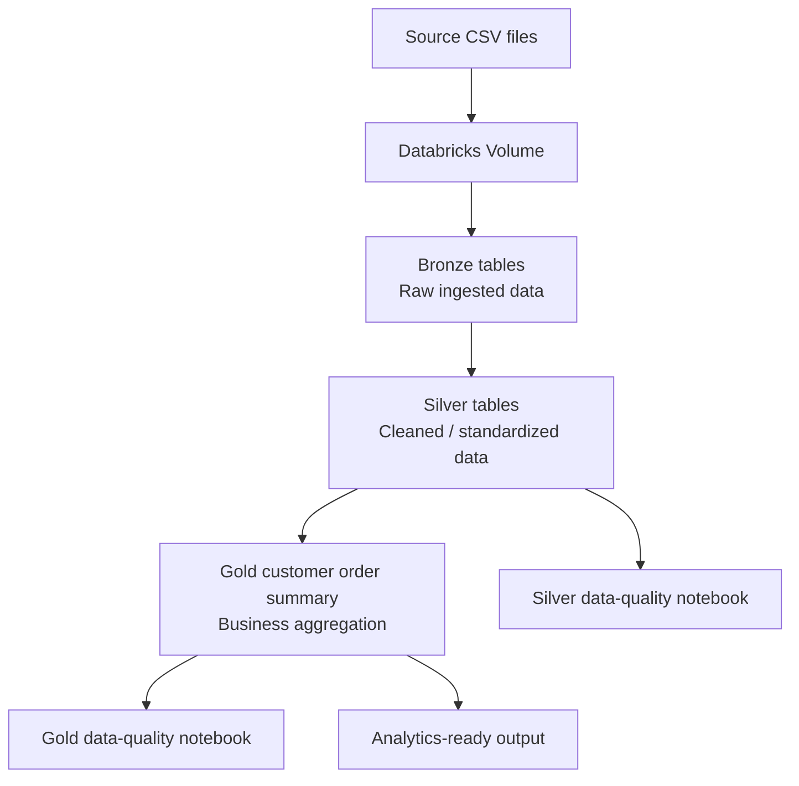

# Project Architecture

## Overview

This project is an e-commerce data engineering pipeline built with Databricks and PySpark. It follows the Medallion Architecture: Bronze, Silver, and Gold. Separate notebooks run data-quality checks against the Silver and Gold outputs.

## Source files

| File | Main purpose |
|---|---|
| `customers.csv` | Customer attributes such as customer ID, name, and country |
| `products.csv` | Product attributes such as product ID, name, and category |
| `orders.csv` | Order details such as order ID, customer ID, date, and status |
| `order_items.csv` | Order line items, including item ID, order ID, product ID, and quantity |

## Data flow

## Layer responsibilities

### 1. Bronze — ingestion

**Notebook:** `01_bronze_ingestion.py`

- Reads the four CSV files from a Databricks Volume.
- Loads the ingested data into Bronze tables.
- Acts as the landing layer for downstream processing.

The exact source paths, table names, and read options should be confirmed in the exported notebook.

### 2. Silver — cleaning and standardization

**Notebook:** `02_silver_transformation.py` (use the actual exported filename if it differs)

Silver tables referenced by this project:

- `workspace.silver.customers`
- `workspace.silver.products`
- `workspace.silver.orders`
- `workspace.silver.order_items`

This layer is intended to provide cleaned, consistent data for analysis. Document only the specific cleaning operations that are present in the exported notebook; do not claim deduplication, type casting, or invalid-row removal unless the code performs them.

### 3. Gold — business aggregation

**Notebook:** `03_gold_analytics.py` (use the actual exported filename if it differs)

The Gold logic joins Silver `orders`, `order_items`, and `customers`, then groups by customer ID, customer name, and country.

Output table:

- `workspace.gold.customer_order_summary`

Metrics described by the current project logic:

- `total_orders`: distinct order count per customer.
- `completed_orders`: distinct orders whose status is `Completed`.
- `cancelled_orders`: distinct orders whose status is `Cancelled`.
- `total_quantity_ordered`: sum of item quantities in the joined rows.

The result is ordered by `total_quantity_ordered` descending. This aggregation does not include product price/revenue unless you explicitly add that calculation.

### 4. Silver data quality

**Notebook:** `04_silver_data_quality.py` (use the actual exported filename if it differs)

The known null checks cover required fields in the four Silver tables. The notebook reports each check as PASS or FAIL based on whether nulls are found. See `data_quality_rules.md` for the exact fields and the distinction between implemented checks and suggested future checks.

### 5. Gold data quality

**Notebook:** `05_gold_data_quality.py` (use the actual exported filename if it differs)

This notebook validates the Gold summary. Update the rules documentation to match the exact checks in the notebook. Do not claim a validation is implemented simply because it is listed as a recommended rule.

## Table naming

Names such as `workspace.silver.customers` use `workspace` as the catalog name. Replace `workspace` with the actual catalog name in your environment if it differs.

## Run order

1. Bronze ingestion
2. Silver transformation
3. Gold analytics
4. Silver data-quality checks
5. Gold data-quality checks

Run upstream notebooks before downstream notebooks, and verify that the expected tables exist before running quality checks.
